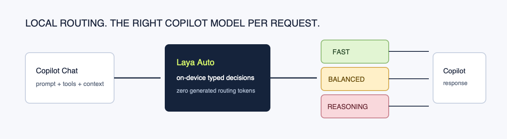
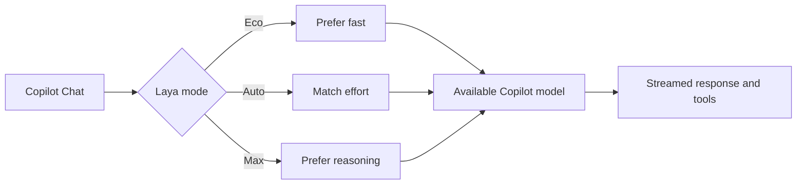

# Laya Router for Copilot



Adds **Laya Auto**, **Laya Eco** and **Laya Max** to the GitHub Copilot Chat model picker. When one is selected, an on-device [Laya](https://github.com/mizorewww/laya-mlx) model reads each request and sends it to the Copilot model that fits: a fast model for renames and greetings, a balanced one for everyday features and fixes, a reasoning model for multi-file refactors, concurrency bugs and architecture.

```text
Copilot Chat ─▶ Laya Auto (this extension) ─▶ laya-copilot (local, MLX)
                     │                          1. language → english / multilingual checkpoint
                     │                          2. 4 typed questions, 1 forward pass, 0 tokens
                     │                          3. effort → tier → best available model
                     ◀──────── decision ────────┘
                     └─▶ vscode.lm model (Haiku / Sonnet / Opus / GPT…) with tools, streamed back
```



The request text never leaves the machine for the routing decision. Agent mode works: tools are forwarded, and one model is kept for the whole turn so a tool loop never switches models midway.

## Install

```bash
# 1. The routing server (Apple Silicon)
pip install 'git+https://github.com/mizorewww/laya-mlx.git' # provides `laya-copilot`
hf download aac6fef/laya-mlx
hf download aac6fef/laya-multilingual-mlx

# 2. The extension
git clone https://github.com/tuncer-byte/laya-auto-mode.git
cd laya-auto-mode && npm install && npm run compile && npm run package
code-insiders --install-extension laya-copilot-router-0.1.0.vsix
```

The extension starts `python -m laya_mlx.copilot` itself (workspace `.venv`, then `python3`; override with `laya.pythonPath`). Or run `laya-copilot` yourself.

Open Copilot Chat, open the model picker and choose **Laya Auto**. If it is not listed, use *Manage Models…* in the picker and enable the Laya Router models. The first request asks you to allow the extension to use Copilot's models.

> Models contributed by extensions are available on Copilot Free/Pro/Pro+. Copilot Business and Enterprise organisations can restrict them; `Laya: Route a Prompt (Dry Run)` still works there.

## What Laya decides

| Question | Type | Used for |
|---|---|---|
| `task` | choice: explain, quick_edit, bug_fix, feature, refactor, architecture, tests, docs, chitchat | prior, weighted by Laya's confidence |
| `complexity` | score 0–3 | main effort term |
| `multi_file` | P(true) | + effort |
| `deep_reasoning` | P(true) | + effort (English checkpoint only) |

Editor context adds to the effort too: attachments, agent mode, a long conversation, a large prompt. Models that cannot take the prompt size are skipped. Effort below 1.4 is `fast`, from 2.3 up it is `reasoning`. Eco subtracts 0.35 and Max adds 0.45.

Weights are fitted per checkpoint by [`benchmarks/calibrate.py`](benchmarks/calibrate.py) on 49 labelled requests ([`benchmarks/routing_set.json`](benchmarks/routing_set.json)):

| Checkpoint | Requests | In-sample | Leave-one-out |
|---|---:|---:|---:|
| English | 30 | 0.87 | 0.80 |
| Multilingual (Turkish) | 19 | 0.74 | 0.47 |

Non-English routing is noticeably weaker: the multilingual checkpoint's task signal is noisy. Use Eco/Max or `laya.tierOverrides` when it misjudges. The set is small and hand-labelled; treat these numbers as a sanity check, not a benchmark.

Run the included benchmark after installing Laya and downloading its checkpoints:

```bash
python benchmarks/calibrate.py
```

It writes `benchmarks/results/copilot-routing.json`, including every prediction and latency sample.

## UI

- **Status bar**: the model and tier of the last decision; hover for the effort breakdown.
- **Laya: Show Routing Decisions**: a panel with every decision, an effort gauge, what added or removed effort, Laya's task probabilities, the checkpoint used and its latency.
- **Chat**: a one-line note at the top of each answer (`laya.showDecisionInChat`).
- **Laya: Show Model Tiers**: which Copilot model sits in which tier.

## Settings

| Setting | Default | |
|---|---|---|
| `laya.preferences` | `{}` | Patterns per tier in priority order, e.g. `{"reasoning": ["opus"], "fast": ["haiku"]}` |
| `laya.tierOverrides` | `{}` | Force a model id or family into a tier |
| `laya.vendors` | `["copilot"]` | Vendors Laya may route to |
| `laya.serverUrl` | `http://127.0.0.1:8765` | Routing server |
| `laya.autoStart` / `laya.pythonPath` | `true` / `""` | Server start-up |
| `laya.showDecisionInChat` | `true` | Routing note in answers |

When the server is unreachable a keyword fallback routes instead, and the note says so.
